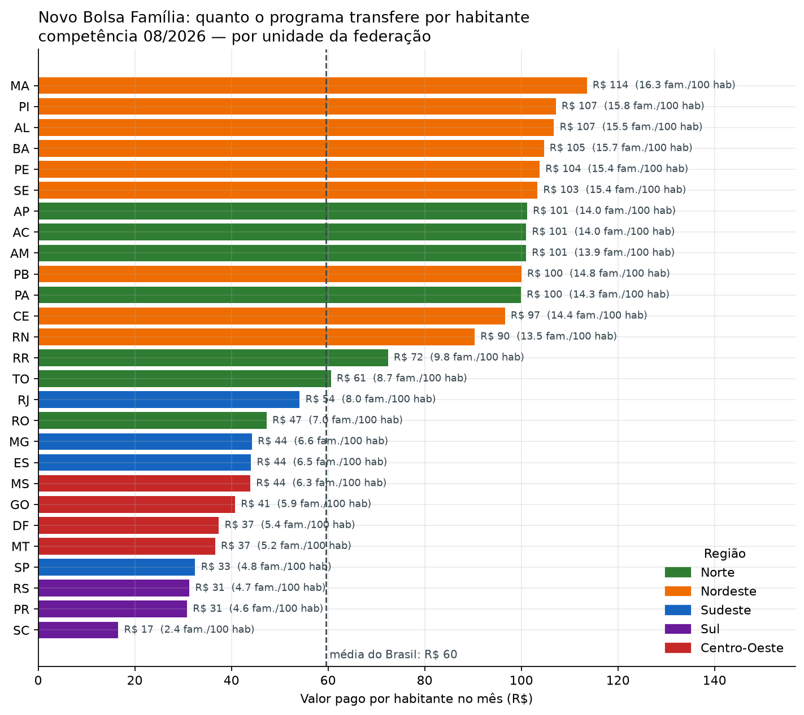

# Onde o Novo Bolsa Família pesa mais

Cruzamento de **57 milhões de pagamentos** do Novo Bolsa Família (Portal da
Transparência) com **população e PIB municipal** do IBGE, em **MongoDB**.

Trabalho da disciplina de Banco de Dados Não Convencionais.

| Integrante | RA |
|---|---|
| Antonio Adolfo Geraldino Bernardo | 828561 |
| Rafael Yugo Hashimoto | 834417 |
| Rafaela Silva Ruis | 834416 |

## A pergunta

Em quais estados e municípios o programa transfere mais dinheiro por habitante e
atende a maior fatia das famílias — e como isso se relaciona com a riqueza local.

O que circula na imprensa é o gasto total do programa, um número de bilhões que
não diz nada sobre o que ele representa na cidade de quem lê. Dividindo o valor
pago pela população de cada município e confrontando com o PIB per capita local,
esse total vira uma informação utilizável.



## Três resultados

**1. O gasto reproduz o mapa da desigualdade regional.** O Maranhão recebe
R$ 113,57 por habitante por mês; Santa Catarina, R$ 16,57 — 6,9 vezes menos. No
Maranhão o programa equivale a 6,42% do PIB estadual ao ano, contra 0,32% em
Santa Catarina.

**2. Quanto mais pobre o município, maior a fatia da população atendida**
(Spearman = −0,73). Mas a faixa de PIB per capita mais alta *sobe de novo*: são
cidades de refinaria e royalties, onde o PIB é inflado sem que a riqueza chegue
às famílias. São Francisco do Conde (BA) tem PIB de R$ 642 mil por habitante e
19,2 famílias por 100 habitantes no programa. **O PIB mede o que se produz no
território, não a renda de quem vive nele.**

**3. A distribuição é bimodal.** Não existe um "município brasileiro médio" no
programa: 2.117 municípios se concentram em 4 a 6 famílias por 100 habitantes
(84% do Sul e do Sudeste) e outros 1.927 em 17 a 19 (87% do Norte e do
Nordeste). A mediana nacional, 9,5, cai no vale entre os dois grupos.

## As duas bases

| | Base 1 | Base 2 |
|---|---|---|
| **Nome** | Novo Bolsa Família — Pagamentos | Municípios, população e PIB |
| **Fonte** | [Portal da Transparência](https://portaldatransparencia.gov.br/download-de-dados/novo-bolsa-familia) | [APIs do IBGE](https://servicodados.ibge.gov.br/api/docs) |
| **Recorte** | competências 202606, 202607 e 202608 | 5.570 municípios; população 2026; PIB 2015–2023 |
| **Volume** | 57.174.504 documentos | 5.571 + 50.139 documentos |

**O problema da integração.** As duas bases não compartilham a chave do
município: o Portal usa o **código SIAFI** (4 dígitos) e o IBGE o **código
IBGE** (7 dígitos). `coleta/de_para_siafi_ibge.py` casa por `(UF, nome
normalizado)` em três níveis — nome exato, similaridade textual acima de 0,85 e
um dicionário de exceções conferido caso a caso — chegando a **100% de casamento
nos 5.571 municípios**. Cada decisão heurística fica registrada em
`saidas/relatorio_de_para.txt`.

**Dados pessoais.** O arquivo do Portal traz nome e NIS do responsável familiar
(o CPF já vem mascarado na origem). Os campos são carregados como publicados,
para manter fidelidade à fonte, mas nenhuma consulta ou gráfico exibe dados
individuais: todos os resultados são agregados por município, UF ou faixa.

## Estrutura

```
coleta/      coletar_ibge.py, coletar_bolsa_familia.py, de_para_siafi_ibge.py
carga/       carga_mongoimport.sh (itens d e e), carga_pymongo.py, indices.js
consultas/   consultas_base1.js, consultas_base2.js (item f),
             explain_antes_depois.js (item g), materializar_resumo.js,
             validacao_numerica.py
notebook/    trabalho_mongo_colab.ipynb (itens h e i), já executado
dados/       coleções pequenas prontas para carregar + dump para o Colab
saidas/      saída real de cada comando, e os PNG em saidas/graficos/
relatorio/   o PDF entregue
```

## Como reproduzir

Pré-requisitos: MongoDB 8 (`mongod`, `mongosh`, `mongoimport`), Python 3.11+,
~35 GB livres durante a carga e conexão com a internet.

```bash
python3 -m venv .venv
.venv/bin/pip install -r requirements.txt

mkdir -p ~/mongodb-trabalho-bd/data ~/mongodb-trabalho-bd/log
mongod --dbpath ~/mongodb-trabalho-bd/data \
       --logpath ~/mongodb-trabalho-bd/log/mongod.log \
       --port 27017 --bind_ip 127.0.0.1 --wiredTigerCacheSizeGB 4 --fork

bash executar_tudo.sh
```

O script roda coleta, carga, consultas, índice e validação, gravando cada saída
em `saidas/`. O notebook é o último passo:

```bash
.venv/bin/jupyter nbconvert --to notebook --execute --inplace \
    notebook/trabalho_mongo_colab.ipynb
```

### Rodando só as consultas

Se o banco já estiver carregado:

```bash
bash executar_tudo.sh --consultas
```

### Ordem que importa

`consultas/explain_antes_depois.js` precisa rodar **antes** de
`carga/indices.js`: ele apaga o índice, mede o plano sem índice, cria o índice e
mede de novo. Se os índices já existirem, o "antes" não é legítimo.

## O notebook no Google Colab

A máquina virtual do Colab roda na nuvem e não enxerga o `localhost` de quem
executa. O caminho oficial seria o *runtime local* com a extensão
`jupyter_http_over_ws`, mas esse pacote foi descontinuado e não funciona com o
Jupyter 7 nem com o Python 3.12+.

A solução: o notebook **sobe o próprio MongoDB dentro da VM do Colab** e
restaura ali `dados/dump_colab.tgz` (14 MB, com as coleções do IBGE, o de-para,
a visão materializada e uma amostra de pagamentos). A célula de conexão escolhe
sozinha entre os modos `local`, `atlas` e `colab`.

Para que o Colab baixe o dump direto deste repositório, preencha `URL_DUMP` na
célula de conexão:

```python
URL_DUMP = "https://raw.githubusercontent.com/USUARIO/REPO/main/dados/dump_colab.tgz"
```

Sem isso, o notebook pede o upload do arquivo.

Para regerar o pacote a partir de um banco carregado:

```bash
bash notebook/gerar_dump_colab.sh
```

## O que não está versionado

Os arquivos brutos são grandes e regeneráveis, então ficam fora do repositório:

| Arquivo | Tamanho | Como recriar |
|---|---|---|
| `dados/*.csv` (Portal da Transparência) | 5,9 GB | `python coleta/coletar_bolsa_familia.py --baixar` (~1 min) |
| `dados/pagamentos_*.jsonl` | 14 GB | `python coleta/coletar_bolsa_familia.py --converter` (~8 min) |
| `.venv` | 830 MB | `pip install -r requirements.txt` |

O que **está** versionado em `dados/`: as coleções do IBGE já convertidas, a
tabela de-para, o cache do universo de municípios do Portal e o dump do Colab —
tudo pequeno e suficiente para recarregar a Base 2 sem bater na API de novo.

## Fontes

* Portal da Transparência do Governo Federal — [Novo Bolsa Família, pagamentos](https://portaldatransparencia.gov.br/download-de-dados/novo-bolsa-familia)
* IBGE — [APIs de Localidades, Agregados (SIDRA 6579 e 5938) e Malhas Territoriais](https://servicodados.ibge.gov.br/api/docs)
* [MongoDB Manual 8.0](https://www.mongodb.com/docs/manual/) · [PyMongo](https://pymongo.readthedocs.io/) · [Matplotlib](https://matplotlib.org/stable/)
